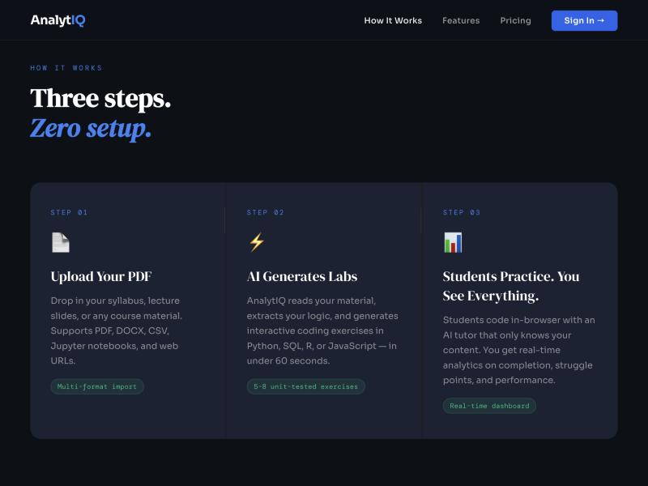
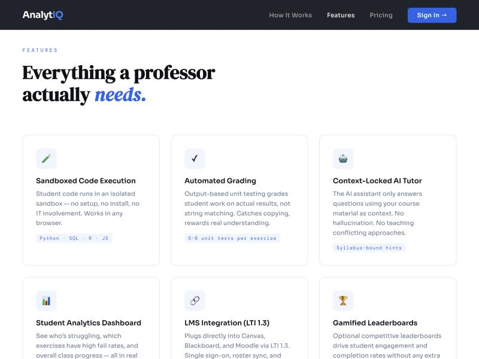

# AnalytIQ

**An AI-powered analytics learning platform that generates coursework from a professor's own
material and grades student code by running it.**

🔗 **Live:** [myanalytiq.com](https://myanalytiq.com) · **Source:** [github.com/adam-elharouchi/AnalytIQ](https://github.com/adam-elharouchi/AnalytIQ)

---

## The product






---

## The problem

Analytics professors face a grading problem that scales badly. Teaching students to write code
means assigning code, and assessing code means either reading every submission by hand or
comparing it to a reference answer as text. Text comparison is the common shortcut, and it is
wrong: two correct solutions to the same problem rarely look alike, and a solution that looks
right can still produce the wrong answer.

The result is that programming assignments in business-analytics courses tend to be rare, small,
and graded on effort. Students get too little practice on the one skill the course exists to teach.

## What AnalytIQ does

A professor uploads a chapter of their own course material. The platform extracts the text,
sends it to Google Gemini, and gets back exercises *with executable test cases* grounded in that
specific chapter — not generic problems from a question bank. The professor reviews and edits
rather than authoring from scratch.

Students reach the exercises through their institution's existing LMS over LTI 1.3, so they never
create a separate account, and grades flow back into the gradebook automatically.

When a student submits, the platform **executes the code in a sandbox and scores the actual
output** against the test cases. There is deliberately no string-similarity or Levenshtein
comparison anywhere in the grading path.

```
PROFESSOR
   │ uploads a course chapter (PDF)
   ▼
content_extractor ──→ Supabase Storage
   │ pypdf extraction, optional chunking (10k chars, 500 overlap)
   ▼
exercise_generator ──→ Google Gemini
   │ returns exercises + test cases as structured JSON
   ▼
class_exercises
   │
STUDENT  ← arrives via LTI launch from Canvas/Moodle, or email+password, or tenant SSO
   │ writes code in the browser
   ▼
code_runner — sandboxed execution
   │ Python · R · JavaScript · SQL · Java
   │ subprocess isolation + RLIMIT_* + import blocklists
   ▼
output-based score (0–100): 80 correctness · 20 code quality
   │
   ▼
grade passback to the LMS gradebook
```

## Architecture

| Layer | Choice | Why |
|---|---|---|
| Backend | Python 3.9, Flask 3.0 (app factory) | Blueprint-per-domain keeps routes, data access, and business logic separate |
| Database | PostgreSQL via Supabase | Row-level multi-tenancy; 14 tracked SQL migrations |
| Async | Redis + Celery (worker + beat) | Exercise generation and PDF extraction are too slow for a request cycle |
| AI | Google Gemini | Exercise generation, the code assistant, and AI-assisted grading |
| Auth | JWT, bcrypt, per-tenant OIDC SSO, LTI 1.3 | Institutions need to bring their own identity provider |
| Execution | subprocess isolation, `RLIMIT_*`, import blocklists, Docker runner | Running untrusted student code is the core security surface |
| Deploy | Render (web + worker), GitHub Actions CI | — |

The codebase separates `blueprints/` (HTTP), `repositories/` (queries), `services/` (business
logic), and `workers/` (async tasks), so the grading path can be tested without a live request.

**Multi-tenancy** runs through the whole system: a `superadmin` tier manages institutions, each
institution gets `tenant_admin` control over its own users, SSO configuration, and branding.

## Scale

| | |
|---|---|
| Commits | 710 |
| Python | ~39,800 lines across 143 files |
| JavaScript | ~13,900 lines |
| Test files | 66 |
| Migrations | 14 |
| Languages graded | Python, R, JavaScript, SQL, Java |
| Build period | December 2025 – present |

## Engineering decisions worth calling out

**Output-based grading over text similarity.** The easy implementation compares a submission to a
reference solution as a string. It is also useless — it rewards students for matching style rather
than solving the problem. Executing the code and checking its output costs a sandbox and a
resource-limit policy, and it is the only approach that actually measures correctness.

**Sandboxing as a first-class concern, not a wrapper.** Accepting arbitrary student code means
accepting that some of it will be hostile or accidentally destructive. Defence is layered:
subprocess isolation, `RLIMIT_*` caps on CPU and memory, import blocklists, and a Docker-based
runner for stronger separation.

**LTI 1.3 instead of a separate login.** Any platform asking students to create another account
loses most of them. LTI is more work up front — key management, launch validation, grade passback
— and it is the difference between a tool a professor can actually assign and a demo.

**Generation logged as a flywheel.** Every generation writes an `exercise_generation_events` row.
Prompt quality is the product, so the data to improve it has to be captured from day one.

## My role

Sole developer and founder. Product direction, architecture, implementation, and deployment,
alongside the fundraising and institutional outreach materials in this folder.

## In this folder

- [`analytiq-pitch-deck.pdf`](analytiq-pitch-deck.pdf) — investor pitch deck
- [`analytiq-product-packet.pdf`](analytiq-product-packet.pdf) — institutional product overview
- [`screenshots/`](screenshots/) — live product screenshots
