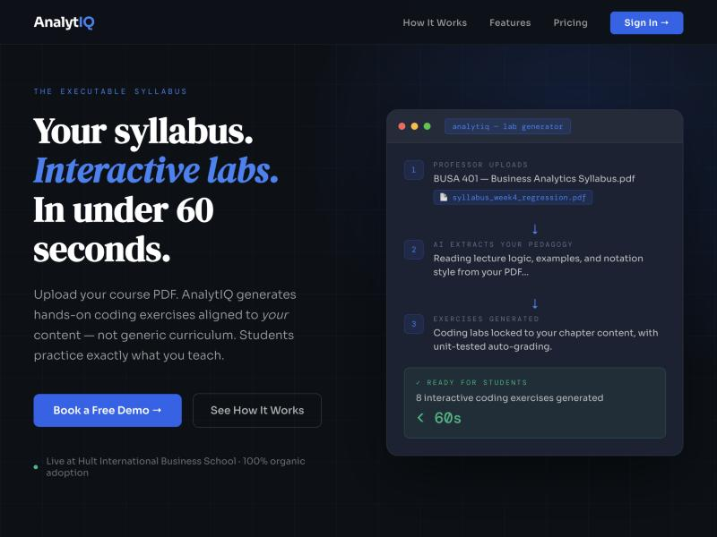

# Adam El Harouchi

**Finance · Business Analytics · Software**

BBA Finance & Business Analytics (STEM), Hult International Business School, Boston

**[→ Portfolio site](https://adam-elharouchi.github.io/portfolio)**

[Finance Resume (PDF)](resume/Adam-El-Harouchi-Resume-Finance.pdf) ·
[Business Analytics Resume (PDF)](resume/Adam-El-Harouchi-Resume-Business-Analytics.pdf) ·
[LinkedIn](https://www.linkedin.com/in/adam-el-harouchi) ·
[Email](mailto:adamelharouchi5@gmail.com)

---

I work at the intersection of financial analysis and applied data science — valuation and
forensic accounting on one side, machine learning and production software on the other.

**Four sections:** [AnalytIQ](#analytiq) · [Finance](#finance) ·
[Business Analytics](#business-analytics) · [Software & Operations](#software--operations)

Every project has a write-up covering the problem, the method, the measured result, and the
limitations.

---

## AnalytIQ

> **An AI-powered analytics learning platform that generates coursework from a professor's own
> material and grades student code by executing it.**
>
> 🔗 **[myanalytiq.com](https://myanalytiq.com)** · [Source](https://github.com/adam-elharouchi/AnalytIQ) · **[Full write-up →](01-analytiq/)**

Analytics professors can't assign much code, because grading it means either reading every
submission by hand or comparing it to a reference answer as text — and text comparison doesn't
measure correctness. AnalytIQ takes a professor's own chapter, generates exercises *with
executable test cases* from it, and scores submissions by **running the code and checking the
actual output**. No string-similarity comparison anywhere in the grading path. It plugs into an
institution's existing LMS over LTI 1.3, so students never create an account and grades flow back
to the gradebook automatically.

| | |
|---|---|
| **Stack** | Python 3.9 · Flask 3.0 · PostgreSQL (Supabase) · Redis + Celery · Google Gemini · Render |
| **Scale** | 710 commits · ~39,800 lines of Python · ~13,900 of JavaScript · 66 test files |
| **Grades** | Python, R, JavaScript, SQL, Java — sandboxed execution with `RLIMIT_*` and import blocklists |
| **Auth** | JWT · bcrypt · per-tenant OIDC SSO · LTI 1.3 with grade passback |
| **Role** | Sole developer and founder — product, architecture, implementation, deployment |

---

## Finance

**[Browse the section →](02-finance/)**

| Project | Method | Conclusion |
|---|---|---|
| [TechnoGlobal forensic accounting](02-finance/technoglobal-forensic-accounting/) | US GAAP review, full restatement | 8 red flags, 3 fraudulent; net income overstated **$141M**; uncovered a hidden debt-covenant breach |
| [Amazon (AMZN) equity research](02-finance/amazon-investment-proposal/) | DCF / FCFF bottom-up, scenarios | **BUY**, $292.99 target (+29.5%), bear case $212.05 |
| [Coca-Cola (KO) equity analysis](02-finance/coca-cola-equity-analysis/) | Comparables + DDM + market sentiment | Fairly valued; DDM outlier explained by model sensitivity |

**Skills** — DCF / FCFF · WACC & CAPM · DDM · comparable company analysis · multiples ·
scenario & sensitivity analysis · US GAAP (ASC 606, 326, 330, 250, 360, 842, 985-20) ·
financial statement restatement · earnings-management detection

---

## Business Analytics

**[Browse the section →](03-business-analytics/)**

| Project | Type | Headline result |
|---|---|---|
| [Football player valuation](03-business-analytics/football-player-valuation/) | Regression | R² 0.992, MAE 149k (tuned Gradient Boosting) |
| [Credit card fraud detection](03-business-analytics/credit-card-fraud-detection/) | Imbalanced classification | 87.8% fraud recall via SMOTE on 284,807 transactions |
| [NYC schools demographics](03-business-analytics/nyc-schools-eda/) | EDA + K-Means | k=2 by silhouette across ~1,800 schools |
| [Breast cancer diagnosis](03-business-analytics/breast-cancer-classification/) | Feature selection | 97.98% with LASSO; KBest and LASSO agree on 2 features |
| [Titanic survival](03-business-analytics/titanic-survival/) | Model comparison | 81.0%; scaling moves KNN/SVM, not trees |
| [Airbnb Vienna pricing](03-business-analytics/airbnb-vienna-regression/) | Regression (SEMMA) | R² 0.13 on 8,302 listings |
| [PCA on handwritten digits](03-business-analytics/pca-digit-recognition/) | Dimensionality reduction | Component loadings mapped back to pixel space |
| [DreamHome SQL labs](03-business-analytics/sql-dreamhome-labs/) | SQL | 137 queries — joins, set operations, correlated subqueries, DDL |

**Skills** — pandas · numpy · scikit-learn · LightGBM · imbalanced-learn · matplotlib · seaborn ·
SQL · regression · classification · clustering · PCA · feature selection · hyperparameter tuning

---

## Software & Operations

**[Browse the section →](04-software-operations/)**

| Project | Stack / focus |
|---|---|
| [Personal finance dashboard](04-software-operations/budgeting-app/) | Next.js 15, TypeScript, Plaid API, Zustand |
| [Voice interview simulator](04-software-operations/interview-simulator/) | Node.js, Express, Anthropic API, Web Speech API |
| [AeroShield operations capstone](04-software-operations/aeroshield-operations/) | Throughput analysis, bottleneck identification, capacity planning |

**Skills** — TypeScript · React / Next.js · Node.js · REST API integration · server-side secret
handling · 4Vs operational analysis · process mapping · theory-of-constraints reasoning

---

## Leadership

President, Hult Competition Hub · President, HULT FC · Head of Volunteers, HBS VCPE ·
Director of Social & Professional Events, Boston Arab Society

---

**Open to roles in financial analysis, business analytics, and data science.**

[Finance Resume](resume/Adam-El-Harouchi-Resume-Finance.pdf) ·
[Business Analytics Resume](resume/Adam-El-Harouchi-Resume-Business-Analytics.pdf) ·
[adamelharouchi5@gmail.com](mailto:adamelharouchi5@gmail.com)

