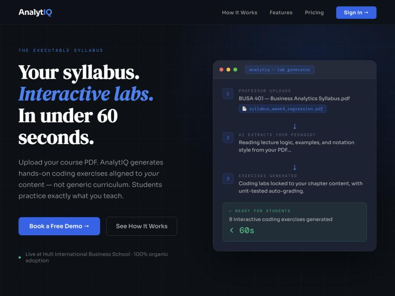

# Adam El Harouchi

**Finance · Business Analytics · Strategic Consulting**

BBA Finance & Business Analytics (STEM), Hult International Business School, Boston

**[→ Portfolio site](https://adam-elharouchi.github.io/portfolio)**

[Finance Resume (PDF)](resume/Adam-El-Harouchi-Resume-Finance.pdf) ·
[Business Analytics Resume (PDF)](resume/Adam-El-Harouchi-Resume-Business-Analytics.pdf) ·
[LinkedIn](https://www.linkedin.com/in/adam-el-harouchi) ·
[Email](mailto:adamelharouchi5@gmail.com)

---

I work at the intersection of financial analysis and applied data science — valuation and
forensic accounting on one side, machine learning and strategy work on the other.

**Sections:** [Entrepreneurial Endeavors](#entrepreneurial-endeavors) ·
[Finance & Strategy](#finance--strategy) ·
[Data & Business Analytics](#data--business-analytics) ·
[Experience & Leadership](#experience--leadership)

Every project has a write-up covering the problem, the method, the measured result, and the
limitations.

---

## Entrepreneurial Endeavors

### AnalytIQ

> **An AI-powered analytics learning platform that generates coursework from a professor's own
> material and grades student code by executing it.**
>
> 🔗 **[myanalytiq.com](https://myanalytiq.com)** · [Source](https://github.com/adam-elharouchi/AnalytIQ) · **[Full write-up →](01-analytiq/)**

Analytics professors can't assign much code, because grading it means either reading every
submission by hand or comparing it to a reference answer as text — and text comparison doesn't
measure correctness. AnalytIQ takes a professor's own chapter, generates exercises *with
executable test cases* from it, and scores submissions by **running the code and checking the
actual output**. No string-similarity comparison anywhere in the grading path. It plugs into an
institution's existing LMS over LTI 1.3, so students never create an account and grades flow back
to the gradebook automatically.

| | |
|---|---|
| **Stack** | Python 3.9 · Flask 3.0 · PostgreSQL (Supabase) · Redis + Celery · Google Gemini · Render |
| **Scale** | 710 commits · ~39,800 lines of Python · ~13,900 of JavaScript · 66 test files |
| **Grades** | Python, R, JavaScript, SQL, Java — sandboxed execution with `RLIMIT_*` and import blocklists |
| **Auth** | JWT · bcrypt · per-tenant OIDC SSO · LTI 1.3 with grade passback |
| **In use** | 4 professors · 5 classes · 41 registered users · 83 exercises generated |
| **Role** | Sole developer and founder — product, architecture, implementation, deployment |

### Also built

| Project | Stack |
|---|---|
| [Personal finance dashboard](05-software/budgeting-app/) | Next.js 15, TypeScript, Plaid API, Zustand |
| [Voice interview simulator](05-software/interview-simulator/) | Node.js, Express, Anthropic API, Web Speech API |

**Skills** — TypeScript · React / Next.js · Node.js · REST API integration · server-side secret handling

---

## Finance & Strategy

### Valuation & Financial Analysis

**[Finance folder →](02-finance/)** · **[Strategy folder →](04-strategic-consulting/)**

| Project | Method | Conclusion |
|---|---|---|
| [TechnoGlobal forensic accounting](02-finance/technoglobal-forensic-accounting/) | US GAAP review, full restatement | 8 red flags, 3 fraudulent; net income overstated **$141M**; uncovered a hidden debt-covenant breach |
| [Amazon (AMZN) equity research](02-finance/amazon-investment-proposal/) | DCF / FCFF, 33-sheet model | **BUY**, $292.99 target (+29.5%), bear case $212.05 |
| [Coca-Cola (KO) equity analysis](02-finance/coca-cola-equity-analysis/) | Comparables + DDM + market sentiment | Fairly valued; DDM outlier explained by model sensitivity |
| [BigTech quarterly analysis](02-finance/bigtech-quarterly-analysis/) | Three-statement analysis, cohort metrics | Nine quarters of financials, churn, and FY2024 projections |
| [Portfolio risk management](02-finance/portfolio-risk-management/) | Portfolio management, hedging | Three holdings exposed to one geopolitical shock in opposite directions, each with a specific defensive instrument |
| [Walmart sales forecasting](02-finance/walmart-sales-forecasting/) | Time-series forecasting | Seven forecasting methods compared across 12 sheets, feeding forecasted financial statements |
| [Best Buy capital budgeting](02-finance/best-buy-capital-budgeting/) | NPV, IRR, PI, payback | Full investment-criteria set on a WACC-derived discount rate, plus 10-K and hedging analysis |

### Strategy & Client Advisory

| Project | Focus | The core of it |
|---|---|---|
| [AeroShield operations capstone](04-strategic-consulting/aeroshield-operations-capstone/) **· [live demo](https://adam-elharouchi.github.io/portfolio/04-strategic-consulting/aeroshield-operations-capstone/platform.html)** | Operations · throughput | A working six-module operations platform delivered to the client, with cycle-time and bottleneck analysis behind it |
| [Korn Ferry AI measurement](04-strategic-consulting/korn-ferry-ai-measurement/) | Strategy · live client | Everyone measures time saved; for a consulting firm quality is the product. A quality audit trail plus a knowledge flywheel, productised as a client offering |
| [Brunk Industries OPS scoring](04-strategic-consulting/brunk-industries-ops-scoring/) **· internship** | Operations · metric design | A composite part-level score weighting returns 5000x against scrap's 1.5x, used to sort the portfolio into stars, cash cows, question marks and dogs |
| [Layers brand strategy](04-strategic-consulting/layers-brand-strategy/) | Brand · live client challenge | People want to grow but don't know how to begin — so the job is making the first step concrete |

**Skills** — DCF / FCFF · WACC & CAPM · DDM · comparable company analysis · multiples ·
scenario & sensitivity analysis · US GAAP (ASC 606, 326, 330, 250, 360, 842, 985-20) ·
financial statement restatement · earnings-management detection

---

## Data & Business Analytics

**[Browse the section →](03-business-analytics/)**

| Project | Type | Headline result |
|---|---|---|
| [Football player valuation](03-business-analytics/football-player-valuation/) | Regression | R² 0.992, MAE 149k (tuned Gradient Boosting) |
| [Credit card fraud detection](03-business-analytics/credit-card-fraud-detection/) | Imbalanced classification | 87.8% fraud recall via SMOTE on 284,807 transactions |
| [NYC schools demographics](03-business-analytics/nyc-schools-eda/) | EDA + K-Means | k=2 by silhouette across ~1,800 schools |
| [Breast cancer diagnosis](03-business-analytics/breast-cancer-classification/) | Feature selection | 97.98% with LASSO; KBest and LASSO agree on 2 features |
| [Titanic survival](03-business-analytics/titanic-survival/) | Model comparison | 81.0%; scaling moves KNN/SVM, not trees |
| [Airbnb Vienna pricing](03-business-analytics/airbnb-vienna-regression/) | Regression (SEMMA) | R² 0.13 on 8,302 listings |
| [PCA on handwritten digits](03-business-analytics/pca-digit-recognition/) | Dimensionality reduction | Component loadings mapped back to pixel space |
| [DreamHome SQL labs](03-business-analytics/sql-dreamhome-labs/) | SQL | 137 queries — joins, set operations, correlated subqueries, DDL |

**Skills** — pandas · numpy · scikit-learn · LightGBM · imbalanced-learn · matplotlib · seaborn ·
SQL · regression · classification · clustering · PCA · feature selection · hyperparameter tuning

---

## Experience & Leadership

**AnalytIQ** — Founder · Dec 2025 – Present · Cambridge, MA
- Built and scaled an AI analytics learning platform to **41 registered users across 4
  professors and 5 classes**, generating **83 exercises** from their own course material
- Architected the full stack (Flask, Supabase/PostgreSQL, GenAI orchestration) and integrated
  **LTI 1.3** for LMS interoperability; drove product from 0 to V2 across dual portals
- [Full write-up](01-analytiq/)

**Blue Green** — Business Intelligence & Analyst Intern · Sep – Dec 2025 · Hybrid
*Promoted from Data Analyst & Migration Intern (Jun – Sep 2025)*
- Project lead on a full-scale cloud data migration: **800+** workbooks, dashboards and datasets
  from legacy GCP Sigma to AWS Sigma in **2.5 months with zero errors**, designing the migration
  plan, SQL replication logic and QA/reconciliation process
- Built **30+** Power BI and Sigma dashboards in 4 months while maintaining a **50+** dashboard
  portfolio for enterprise clients **Fiserv, Clover and Fidelity**
- Primary liaison across **8+** internal and client stakeholder teams; delivered monthly
  cross-source reporting and partnered on go-to-market and product packaging strategy

*Client work under NDA — described here, no files published.*

**Brunk Industries** — Finance Analyst Intern · Mar – Jun 2025 · Remote
- Built DCF models, revenue forecasts and cost-revenue analyses in Excel and Python, informing
  **3 strategic expansion proposals** with **$500K+** projected revenue impact — all approved
- Analysed SAP budget-vs-actual reports to isolate cost inefficiencies, driving a **7% cost
  improvement** across manufacturing units
- Benchmarked **10–15** manufacturing companies and researched expansion into clean energy
- Designed a composite part-level operations score, approved by leadership —
  [see the write-up](04-strategic-consulting/brunk-industries-ops-scoring/)

**Wafa IMA Assistance** — Accounting & Finance Intern · May – Jun 2024 · Casablanca, Morocco
- Recorded and organised daily financial transactions, supporting the finance team's reporting cycle
- Assisted with budget preparation, financial projections and day-to-day accounting operations

### Leadership

**[Browse the section →](06-leadership/)**

Vice President & Director of Events, Boston Arab Society · former President, Hult Competition
Hub · former President, Hult FC · former Head of Volunteers, HBS VCPE

Raised $7.5K for The Home for Little Wanderers, running the Boston Marathon.

Two of those roles came with a budget. The [club finance workbooks](06-leadership/club-finance/)
cover estimated vs. actual across a HULT FC season and per-event P&L plus bank reconciliation
for the Boston Arab Society.

---

**Open to roles in financial analysis, business analytics, and consulting.**

[Finance Resume](resume/Adam-El-Harouchi-Resume-Finance.pdf) ·
[Business Analytics Resume](resume/Adam-El-Harouchi-Resume-Business-Analytics.pdf) ·
[adamelharouchi5@gmail.com](mailto:adamelharouchi5@gmail.com)

